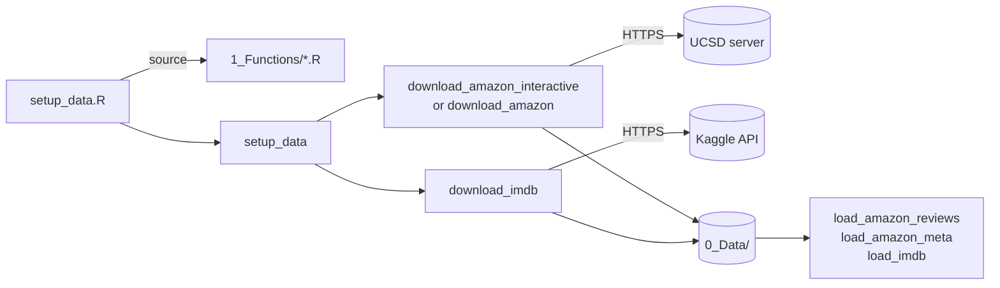

# ai_learning

Learning project for working with text review data in R. This wiki documents the code that
downloads the datasets and loads them for cleaning.

## Datasets

| Dataset | Source | Stored in |
|---|---|---|
| Amazon Reviews 2023 | [amazon-reviews-2023.github.io](https://amazon-reviews-2023.github.io/) (McAuley Lab, UCSD) | `0_Data/amazon_reviews_2023/` |
| IMDB 50K movie reviews | [Kaggle](https://www.kaggle.com/datasets/lakshmi25npathi/imdb-dataset-of-50k-movie-reviews) | `0_Data/imdb_50k/` |

The data is **not** in git: `0_Data/` is in `.gitignore`, and each person downloads it locally
with [setup_data.R](Script-setup_data).

## Quick start

```r
install.packages(c("curl", "jsonlite"))
```

Then, in RStudio, open `ai_learning.Rproj`, open `1_Data_Cleaning/setup_data.R` and click
**Source**. Or, from a terminal:

```bash
Rscript 1_Data_Cleaning/setup_data.R
```

## Code base structure

```
ai_learning/
├── ai_learning.Rproj               RStudio project (sets the working directory to the repo)
├── README.md
├── .gitignore                      ignores 0_Data/, credentials, R session files
├── 0_Data/                         local datasets (git-ignored, created by setup_data.R)
│   ├── amazon_reviews_2023/
│   │   ├── reviews/<Category>.jsonl.gz
│   │   └── meta/meta_<Category>.jsonl.gz
│   └── imdb_50k/IMDB Dataset.csv
├── 1_Data_Cleaning/
│   ├── setup_data.R                entry point: downloads the datasets
│   └── 1_Functions/                helper functions (no code runs when they are loaded)
│       ├── config.R                paths, URLs, category list
│       ├── utils.R                 downloads, size lookups, prompts, argument parsing
│       ├── download_amazon_reviews.R   Amazon downloader + interactive menu
│       ├── download_imdb.R         IMDB downloader (Kaggle)
│       └── load_data.R             loaders into data frames
└── wiki/                           source of these wiki pages
```

| File | Purpose |
|---|---|
| [setup_data.R](Script-setup_data) | The script you run to download the datasets. |
| [config.R](File-config) | Paths, URLs and dataset settings shared by all other files. |
| [utils.R](File-utils) | General helpers: package checks, downloads, size lookups, prompts and command-line parsing. |
| [download_amazon_reviews.R](File-download_amazon_reviews) | Downloads Amazon Reviews 2023 files and runs the interactive menu. |
| [download_imdb.R](File-download_imdb) | Downloads the IMDB 50K movie reviews dataset from Kaggle. |
| [load_data.R](File-load_data) | Loads the downloaded datasets into data frames for cleaning and analysis. |

## How it fits together



1. `setup_data.R` finds the repo and loads every file in `1_Functions/`.
2. [`setup_data()`](setup_data) runs the Amazon step (interactive menu or a fixed list of
   categories), then the IMDB step.
3. Files are written to `0_Data/`; files you already have are skipped.
4. Your own scripts load the same helpers and read the data with the
   [load functions](File-load_data).

## Dependencies

| Dependency | Needed for | Required |
|---|---|---|
| R ≥ 4.1 | everything | yes |
| [`curl`](https://cran.r-project.org/package=curl) | downloads, size lookups | yes |
| [`jsonlite`](https://cran.r-project.org/package=jsonlite) | reading Amazon JSON Lines, `kaggle.json` | yes |
| [`rstudioapi`](https://cran.r-project.org/package=rstudioapi) | finding the repo when running `setup_data.R` line by line in RStudio | optional |
| Network access to `mcauleylab.ucsd.edu` | Amazon data | for downloading |
| Network access to `www.kaggle.com` (+ optional Kaggle account) | IMDB data | for downloading |

## Configuration

Optional environment variables (e.g. in `~/.Renviron`):

| Variable | Effect |
|---|---|
| `AI_LEARNING_DATA_DIR` | Store data somewhere other than `<repo>/0_Data`. |
| `AMAZON_2023_BASE_URL` | Use a different Amazon Reviews 2023 server or mirror. |
| `IMDB_KAGGLE_URL` | Use a different IMDB download URL. |
| `KAGGLE_USERNAME`, `KAGGLE_KEY` | Kaggle credentials (alternative to `~/.kaggle/kaggle.json`). |
| `KAGGLE_API_TOKEN` | Kaggle API token, sent as a bearer token. |
| `KAGGLE_CONFIG_DIR` | Folder containing `kaggle.json` (default `~/.kaggle`). |

## All functions

| Function | Description |
|---|---|
| [`setup_data`](setup_data) | Downloads every dataset into `0_Data/`. This is what runs when you source or `Rscript` the setup script. |
| [`amazon_url`](amazon_url) | Builds the download URL of one Amazon Reviews 2023 file. |
| [`amazon_path`](amazon_path) | Local path where one Amazon Reviews 2023 file is (or will be) stored. |
| [`%\|\|%`](null-default-operator) *(internal)* | Returns `a`, or `b` when `a` is `NULL`. Base R only has this operator from 4.4, so it is defined here for older versions. |
| [`check_packages`](check_packages) *(internal)* | Stops with a ready-to-paste `install.packages()` command if required packages are missing. |
| [`human_size`](human_size) *(internal)* | Formats a byte count for display. |
| [`remote_sizes`](remote_sizes) *(internal)* | Asks the server how big each file is, without downloading it. |
| [`download_file`](download_file) *(internal)* | Downloads one file with a progress bar, safely. |
| [`can_prompt`](can_prompt) *(internal)* | Tells whether a person can answer questions. |
| [`ask`](ask) *(internal)* | Asks the user a question and returns the typed line. |
| [`parse_args`](parse_args) *(internal)* | Minimal command-line parser for `Rscript` options. |
| [`flag`](flag) *(internal)* | Checks whether a value-less flag was given. |
| [`category_arg`](category_arg) *(internal)* | Turns a category option into a vector of category names. |
| [`download_amazon`](download_amazon) | Downloads chosen parts of chosen Amazon categories, without prompts. |
| [`amazon_status`](amazon_status) | Builds a table of every Amazon file: where it comes from, where it goes, whether you have it and how big it is. |
| [`print_status_table`](print_status_table) | Prints the category table shown by the interactive menu. |
| [`parse_selection`](parse_selection) *(internal)* | Turns what the user typed in the menu into category names. |
| [`amazon_select`](amazon_select) *(internal)* | Runs the interactive menu and returns the choice, without downloading. |
| [`download_amazon_interactive`](download_amazon_interactive) | The interactive menu followed by the download. |
| [`kaggle_handle`](kaggle_handle) *(internal)* | Creates a `curl` handle carrying your Kaggle credentials, if any are set. |
| [`download_imdb`](download_imdb) | Downloads the IMDB 50K movie reviews from Kaggle into `0_Data/imdb_50k/`. |
| [`.check_file`](check_file) *(internal)* | Stops with a helpful message if a data file is missing. |
| [`read_jsonl_gz`](read_jsonl_gz) *(internal)* | Reads a gzipped JSON Lines file into a data frame. |
| [`load_amazon_reviews`](load_amazon_reviews) | Loads one category's Amazon reviews. |
| [`load_amazon_meta`](load_amazon_meta) | Loads one category's Amazon item metadata. |
| [`load_imdb`](load_imdb) | Loads the IMDB 50K movie reviews. |
